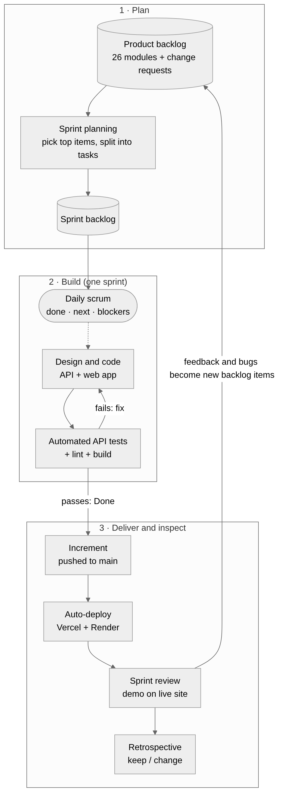

# 3. Development Methodology

## Methodology used: Agile (Scrum)

Cartify was built with **Agile Scrum**, an **iterative and incremental** model. The work was split into
short iterations (sprints). Each sprint added a few modules, tested them, and produced a working version of
the store that could be shown and improved.

## Why Scrum?

- **Requirements changed during the project.** Testing the live site showed things to change. For example,
  sign-up moved from an email link to a 6-digit code, and online orders are now placed only *after* the
  payment succeeds. Scrum treats such changes as normal backlog items.
- **Working software early.** The core store (login, products, bag, orders) worked first, and features were
  added on top of it.
- **Small team, fixed deadline.** Three members and about 10 weeks; short sprints keep everyone focused.
- **Risky outside services.** Razorpay, email and AI were added one sprint at a time and tested separately.

## Why not other models?

| Model | Why it was not chosen |
|---|---|
| Waterfall | Needs all requirements fixed at the start; our requirements changed after testing |
| Spiral | Built for large, high-risk projects; too heavy for a 3-person team |
| Prototype | Good for exploring the UI, but we needed a complete, working product |

## How Scrum was applied

| Scrum element | In Cartify |
|---|---|
| Product Owner | ____________ (decides feature priority) |
| Scrum Master | ____________ (runs meetings, removes blockers) |
| Development Team | M. Dheeraj, S. Pavan Teja, V. Chakradhar |
| Product backlog | The 26 modules in `README.md` plus change requests from testing |
| Sprint backlog | The modules chosen for the current sprint, split into tasks |
| Increment | Tested code pushed to `main`, which deploys automatically to Vercel and Render |
| Meetings | Sprint planning, daily scrum, sprint review (demo), retrospective |

## Increments delivered (from the Git history)

| Increment | Date | What was delivered |
|---|---|---|
| 1 | 3 Sep 2026 | Core store: accounts, products, categories, bag, checkout, orders, reviews, AI assistant and compare, admin dashboard |
| 2 | 8 Oct 2026 | Wishlist, coupons, Razorpay payments, invoices, returns, emails, Q&A, voice search, settings, activity log, CSV reports, recommendations |
| 3 | 11 Nov 2026 | Bug fixes (stock overselling, logout), regression tests, policy pages, saved addresses, sizes/colours, courier tracking, low-stock alerts |
| 4 | 11 Nov 2026 | Changes from review: real-email check, order only after payment, "Others" category, deployment guide and fixes |

## Definition of Done

A task was "done" only when:

1. the feature works through the API and the web app;
2. its automated API test script passes (17 scripts, 479 checks in total);
3. `npm run lint` and `npm run build` pass for the web app;
4. no secrets (`.env` files) are committed;
5. it is pushed to `main` and works on the deployed site.

## Tools

| Purpose | Tool |
|---|---|
| Version control | Git and GitHub |
| Coding | Claude Code (AI coding assistant) |
| Testing | Node.js API test scripts, Playwright (browser tests) |
| Deployment | Vercel (web app), Render (API), MongoDB Atlas (database) |
